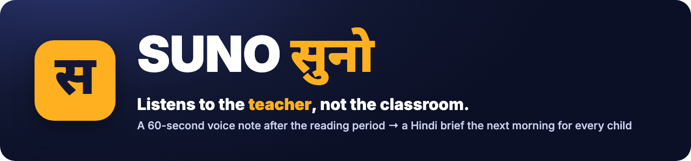
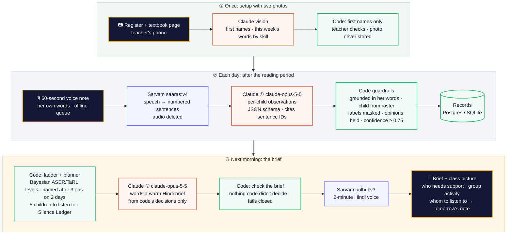

<p align="center"></p>

<p align="center">
<b>Team Sunvai</b> · AI for Foundational Learning Hackathon (Hack2Skill × ShikshaNext × Central Square Foundation × Anthropic) · <b>Challenge 2: Learning-Level Visibility</b>
</p>

**SUNO** (सुनो, "listen") gives Grade 1–3 government-school teachers a clear, per-child picture of reading levels **without a single test and without recording any child**. After the reading period the teacher speaks a 60-second voice note in her own words. Next morning she hears a 2-minute Hindi brief: who needs support with what, a 10-minute small-group activity, and which five children to listen to today, so quiet children are never missed.

## Quick links for judges

| What | Link |
|---|---|
| ▶️ **Live app** (no install; phone or laptop) | **https://suno-8qoh.onrender.com** · sign in with code **`SUNO-DEMO`** |
| 🎬 **Demo video** (3 min) | https://youtu.be/GG3v7lQ212M |
| 📊 **Build deck** | [PDF in the browser](https://suno-8qoh.onrender.com/deck) · [PowerPoint](https://suno-8qoh.onrender.com/deck.pptx) |
| 📦 **Judges' pack** (video, deck, sample inputs, evaluation results) | [GitHub release: build-submission](https://github.com/TusharTechs/suno/releases/tag/build-submission) |
| 🧪 **How we tested SUNO** (in the app) | https://suno-8qoh.onrender.com/#evidence |
| 🔒 **Privacy** (in the app) | https://suno-8qoh.onrender.com/#privacy |
| 🧭 **User inputs and what we changed** | [docs/decisions.md](docs/decisions.md) |
| 📈 **Evaluation results** (every number from a script) | [eval/results/](eval/results/) |
| 🛣️ **Roadmap and integration** | [docs/roadmap.md](docs/roadmap.md) |
| 🤖 **Prompts and JSON schemas** (versioned) | [prompts/](prompts/) · [schemas/](schemas/) |
| 🛡️ **Guardrail code** and its tests | [server/pipeline/guardrails.py](server/pipeline/guardrails.py) · [tests/](tests/) |
| 🏗️ **Architecture** | [below](#architecture) |
| 💻 **Run it locally** (macOS, Linux, Windows, Docker) | [below](#run-locally) |

> Hosting is Render's free plan: after 15 idle minutes the first visit takes about a minute to wake the server.

## Try it in 5 minutes

**Test credentials.** SUNO has **one role: the teacher**. There is no admin, student or parent login, and no teacher score anywhere, by design.

| What to test | How to sign in |
|---|---|
| A class already in use (recommended) | Code **`SUNO-DEMO`**. Each sign-in gets its own fresh copy of a synthetic Grade 2 class (30 fictional children, eight school days of notes already processed, this morning's brief), so reviewers can't disturb each other. |
| Setting up a new class | On the sign-in page choose **create your own class**. SUNO gives a class code (like `K7Q2-M9XD`) that opens it on any phone. |

**Suggested path:**
1. **आज / Today:** play the morning brief. It names who needs support with what, today's activity, and the five children to listen to.
2. **बोलिए / Note:** record a note, type one, or open *sample notes* and send one. Try **"Hard cases"**: two children named Priya, a label (कमज़ोर), a name not on the roster, and an opinion.
3. **See what SUNO understood:** green = evidence, amber = "listen again tomorrow", red = a one-tap question ("which Priya?"). Open **"How SUNO decided"** for Claude's raw output, every code check and the confidence arithmetic.
4. **कक्षा / Class:** each child's level on the ASER/TaRL ladder, groups, and progress week by week. A level appears only after 3 checked observations on 2 days.
5. **Today → "next morning":** moves the demo one school day forward and builds that morning's brief live, including your note (about 30 s).
6. **Offline:** turn the network off, record a note, turn it back on. It sends itself.

**Sample inputs (all synthetic):**

| # | Input | Where | What it shows |
|---|---|---|---|
| 1 | "An ordinary day" (Hindi voice note) | Note → *sample notes* | Per-child observations from her own words: a misreading (कमल as क-म-ल), a correct read, an absence |
| 2 | "Hard cases" (Hindi voice note) | same | Two Priyas (one tap), a label (masked, never evidence), a name not on the roster, an opinion that becomes "check tomorrow" |
| 3 | "Maths and home language" (voice note) | same | Two-digit numbers, adding, place value, and a child who understood a question only in Bhojpuri |
| 4 | "Hinglish" (code-mixed voice note) | same | Names in Latin script resolved to the roster, an English misreading (sun as son), blending, an absence |
| 5 | Attendance register photo ([register.jpg](samples/synthetic/images/register.jpg)) | ☰ → Children → *try a sample photo* | First names only: surnames, fathers' names and marks dropped; the photo is not stored |
| 6 | Textbook page photo ([textbook.jpg](samples/synthetic/images/textbook.jpg)) | ☰ → This week's lesson → *try a sample page* | This week's words, matras, sentences and questions, by skill |

## The problem, and why it is technically hard

76.6% of Class 3 children in government schools can't read a Class 2 text (ASER 2024). A teacher with 35 children hears exactly where each one gets stuck, but by the next day it's gone, and exams twice a year come too late. Assessment apps add a test event, one child at a time. **SUNO adds no test: it keeps what the teacher already notices, checks it, and turns it into tomorrow's plan.**

Doing that well is hard:
- **You can't listen to the classroom.** We tried first. Our feasibility test on real child voices ([docs/feasibility.md](docs/feasibility.md)) showed voice matching cannot tell which child answered. Back benches are too far, phones overheat, and recording children needs consent. So SUNO listens to the teacher instead.
- **Teacher speech is messy.** Code-mixed Hindi and English, nicknames, two children with the same name, "one child", roll numbers said aloud, opinions ("सोनू तो कमज़ोर है"), and habits rather than today's events.
- **Speech-to-text can erase the evidence.** "पिंकी ने किताब को कताब पढ़ा" can come back as "किताब को किताब", which turns a mistake into a correct read.
- **Evidence is sparse.** A teacher mentions about 5 children a day. Levels must be inferred under uncertainty, and the next observation must be chosen to tell us the most.
- **A wrong label harms a child.** Precision matters more than recall: when unsure, the answer is "not enough evidence yet".
- **Real conditions:** low connectivity, ₹8–10k Android phones, one minute of teacher time, and about ₹100 per child per year.

## Architecture



A more detailed diagram: [docs/img/architecture.png](docs/img/architecture.png).

| Layer | What happens | Code |
|---|---|---|
| Input | Voice note (MediaRecorder; offline queue in IndexedDB) or typed note; register and textbook photos at setup | `web/app.js` |
| Processing | Speech to text, split at pauses, numbered sentences; Claude ① reads the note | `server/pipeline/asr.py`, `claude_observations.py` |
| Guardrails | Grounding, roster resolution, item check, label masking, erased-misreading check, computed confidence | `guardrails.py`, `names.py`, `confidence.py` |
| Decisions | Bayesian ladder levels, listening plan, Silence Ledger, whole-class reteach or move on | `ladder.py`, `planner.py`, `tracker.py` |
| Output | Claude ② words the brief; code checks it; Sarvam voices it | `brief.py`, `tts.py` |
| Teacher in the loop | ✓/✗ on every record; one-tap name questions; "How SUNO decided" trace | `server/api.py`, `web/app.js` |

## How we use AI, and where we deliberately don't

| Model | Called | Input → output | Why this model |
|---|---|---|---|
| **Claude** `claude-opus-5-5`, call ① | each note | transcript + roster + lesson → JSON observations ([schema](schemas/observations.v2.json), [prompt](prompts/observations.v3.md)): child, skill, item, right/wrong, mistake type, cited sentence IDs, whole-class remarks | Understanding messy, code-mixed Hindi speech, and telling an observation from an opinion, is where an LLM is strong |
| **Claude** `claude-opus-5-5`, call ② | each morning | code's decisions → a warm 2-minute Hindi script ([schema](schemas/brief.v3.json), [prompt](prompts/brief.v4.md)) | Natural, respectful Hindi a teacher wants to listen to |
| **Claude** vision | setup only | register photo → first names; textbook page → items by skill ([roster](prompts/roster_photo.v1.md), [lesson](prompts/lesson_photo.v1.md)) | Reads handwriting and printed Hindi from a phone photo |
| **Sarvam** `saaras:v4` | each note | 60 s of audio → Hindi transcript | Built for Indian languages and code-mixed speech |
| **Sarvam** `bulbul:v3` | each morning | Hindi script → MP3 voice | Natural Hindi voice, small files |

**Claude API features used:** JSON-schema structured outputs, adaptive thinking with explicit effort (high for reading notes, medium for the brief), prompt caching of the stable roster and lesson prefix (95% of note input served from cache), server-side fallback, and image input. Prompts and schemas are versioned files; one module per pipeline stage.

**What AI is never allowed to do.** Code, not the model:
- **sets every confidence score.** It is computed from who, how specific, how concrete and how recent; the gate is 0.75;
- **decides who a child is**, from the roster: phonetic names across Devanagari and Latin, and roll numbers. When unsure it asks the teacher, never guesses;
- **decides every level and every "needs support"**, with a Bayesian ladder: named only after 3 observations on 2 days;
- **picks whom to listen to tomorrow**, by information gain, with quiet children kept in view;
- **checks the brief:** if Claude says anything code didn't decide, or uses a banned word, it is rejected and code's own text is used (fail closed).

## What we built

- **Guardrails** ([guardrails.py](server/pipeline/guardrails.py)):
  - every claim must cite real sentence IDs, and its quote and item must appear in her words;
  - the child Claude names must match the child code resolves;
  - labels such as "weak", "slow" or कमज़ोर are masked (English and Hindi list);
  - opinions and vague remarks become "listen to them tomorrow", never evidence;
  - "X को X पढ़ा" (speech-to-text erasing a misreading) can't count as correct;
  - evidence needs a specific word or sum.
- **Names** ([names.py](server/pipeline/names.py)): a phonetic key across scripts, exact match first, a close match only with the same first sound, nicknames from the roster, roll numbers in digits or Hindi words, and spoken roll forms next to रोल / नंबर.
- **Learning model** ([ladder.py](server/pipeline/ladder.py)):
  - the ASER/TaRL reading ladder (beginner → letter → word → sentence → story) and a maths ladder;
  - likelihood bands and evidence that fades with a 42-day half-life;
  - the mistake type counts as evidence (क-म-ल means the letters are known);
  - an optional ASER-style starting level, which fades as notes arrive.
- **Planner** ([planner.py](server/pipeline/planner.py)):
  - a 5-child listening list with two items each, one at the likely level and one a rung away;
  - the Silence Ledger, so no child goes unheard for long;
  - a whole-class "reteach or move on" decision;
  - a nudge after each note for listed children she didn't mention.
- **Teacher app** ([web/](web/)):
  - an installable PWA, Hindi or English (one at a time), voice first;
  - an offline note queue and an offline brief;
  - one-tap name questions, a daily reminder in the phone's own calendar, a class picture with progress, and a CSV export.
- **Backend** ([server/](server/)): FastAPI; SQLite locally or Postgres hosted; background jobs; per-login demo sandboxes; per-class data isolation; daily usage caps; an aggregate export with no names (`/api/export/summary.json`) for block dashboards.
- **Tests** ([tests/](tests/)): 86 tests covering guardrails, adversarial cases (shared names, labels, unknown names, opinions, erased misreadings), the planner, brief checks and the API flow. They need no keys.

## Evaluation (every number comes from a script in `eval/`)

| Test | Result | Source |
|---|---|---|
| **Real speech:** one team member, 15 recordings, quiet room / fan / classroom noise, ordinary phone | 0 of 56 evidence records about the wrong child; 56 of 56 in the right direction; 0 of 21 opinions became evidence; 98% of clear observations captured; 15 of 15 absences; word error rate 15–22% | [real_notes.md](eval/results/real_notes.md) |
| **Pipeline simulation:** 32 simulated voice notes, 4 teacher styles, real Sarvam speech-to-text | 0 of 101 records about the wrong child; 101 of 101 in the right direction; 0 of 42 opinions became evidence; 17 of 19 unclear names resolved by one tap | [sim_pipeline.md](eval/results/sim_pipeline.md) |
| **Term simulation:** 200 simulated 12-week terms, listening list (followed 80%) vs a perfect diary of what she notices | Quietest third heard by week 2: 93% vs 41%. Children needing support found by week 8: 50% vs 26%. Quiet children's gaps: 36% vs 4%. Precision about 98% | [sim_term.md](eval/results/sim_term.md) |
| **ASER-calibrated classrooms:** the same term with ASER 2024's published reading levels and attendance for India, UP, Bihar, MP, Rajasthan | Children needing support found by week 8: 51–59% vs 31–37%; precision about 99% in every state | [sim_aser.md](eval/results/sim_aser.md) |
| **Feasibility test F1:** voice matching on 200 real children's voices in a simulated classroom | It cannot name the child, so SUNO stopped recording classrooms | [f1_voice_id.md](eval/results/f1_voice_id.md) |
| **Running cost**, from logged usage | ₹17.6 per teacher per school day, about ₹117 per child per year | [cost.md](eval/results/cost.md) |

**Honest limits.** Simulated results are labelled SIMULATED. The real-speech speaker is one adult man; most primary teachers are women. No real teacher has used SUNO in her class yet: that is the November pilot, with SUNO's levels compared against a blind ASER check ([roadmap](docs/roadmap.md)). Every design change from mentors and tests is logged in [docs/decisions.md](docs/decisions.md).

## Run locally

You need **Python 3.12** (uv installs it for you), **[uv](https://docs.astral.sh/uv/)** and **ffmpeg**. Keys go in `.env`; copy [`.env.example`](.env.example). The demo class, the tests and the term simulations work **without keys**. Sending a new note or building a brief needs both keys.

| Key | Used for | Where to get it |
|---|---|---|
| `ANTHROPIC_API_KEY` | Claude: reading notes, the brief, the photos | https://console.anthropic.com |
| `SARVAM_API_KEY` | Speech-to-text and the Hindi voice | https://dashboard.sarvam.ai |

**macOS**
```bash
brew install uv ffmpeg
git clone https://github.com/TusharTechs/suno.git && cd suno
cp .env.example .env            # then add your two keys
uv sync
uv run uvicorn server.api:app --reload --port 8765
# open http://localhost:8765 and sign in with SUNO-DEMO
```

**Linux** (Debian/Ubuntu; use your package manager elsewhere)
```bash
sudo apt-get update && sudo apt-get install -y ffmpeg git curl
curl -LsSf https://astral.sh/uv/install.sh | sh && source $HOME/.local/bin/env
git clone https://github.com/TusharTechs/suno.git && cd suno
cp .env.example .env            # then add your two keys
uv sync
uv run uvicorn server.api:app --reload --port 8765
```

**Windows** (PowerShell)
```powershell
winget install --id=astral-sh.uv -e
winget install --id=Gyan.FFmpeg -e      # then open a new terminal so ffmpeg is on PATH
git clone https://github.com/TusharTechs/suno.git; cd suno
Copy-Item .env.example .env             # then add your two keys
uv sync
uv run uvicorn server.api:app --reload --port 8765
```

**Docker** (any system)
```bash
docker build -t suno .
docker run -p 8000:8000 --env-file .env suno     # open http://localhost:8000
```

**Tests and evaluations**
```bash
uv run python -m pytest                          # 86 tests, no keys needed
uv run python eval/sim/run_term_sim.py --runs 200    # term simulation, no API calls
uv run python eval/sim/run_aser_sim.py --runs 200    # ASER 2024-calibrated classes, no API calls
uv run python eval/sim/run_pipeline_sim.py --days 8  # pipeline simulation, about $3 of Claude credit
uv run python eval/cost.py                       # running cost from logged usage
```

The microphone works on `localhost` and on HTTPS. Data is kept in `var/` (SQLite), or in Postgres when `SUNO_DATABASE_URL` is set. Deploy: [`render.yaml`](render.yaml) is a Render Blueprint (free web service + free Postgres); enter the two keys in the Render dashboard.

## Project structure

```
suno/
├── server/
│   ├── api.py              FastAPI: web API + the teacher app, per-class isolation, exports
│   ├── jobs.py             background jobs: process a note, build the morning brief
│   ├── store.py            storage: SQLite locally, Postgres when hosted
│   ├── demo.py             per-login sandboxes of the synthetic demo class
│   └── pipeline/           one module per stage
│       ├── asr.py              Sarvam speech-to-text, split at pauses, sentences
│       ├── claude_observations.py  Claude ①: the teacher's note → observations
│       ├── guardrails.py       grounding, labels, opinions, erased misreadings
│       ├── names.py            roster resolution across Devanagari and Latin, roll numbers
│       ├── confidence.py       confidence computed in code
│       ├── ladder.py           Bayesian ASER/TaRL levels
│       ├── tracker.py          Silence Ledger
│       ├── planner.py          listening list, class view, progress
│       ├── brief.py            Claude ②: the brief, and its code check (fails closed)
│       ├── tts.py              Sarvam Hindi voice
│       ├── roster_photo.py     Claude vision: register → first names
│       └── lesson_photo.py     Claude vision: textbook page → this week's items
├── prompts/                versioned prompts for every Claude call
├── schemas/                versioned JSON schemas for every Claude call
├── config/                 skill ladder and activity bank
├── web/                    teacher app (PWA, offline queue, हिं | EN); the deck at /deck
├── tests/                  guardrail, adversarial, planner, brief and API tests
├── eval/
│   ├── sim/                pipeline, term and ASER-calibrated simulations
│   ├── real_notes/         real-speech test scorer
│   ├── feasibility/        F1: voice matching on real child voices
│   ├── results/            every number we report
│   └── cost.py, seed_demo.py, make_samples.py
├── samples/synthetic/      demo class, sample notes and audio, sample photos (all synthetic)
├── docs/                   decisions log, feasibility test, roadmap, real-speech protocol, images
├── Dockerfile, render.yaml, pyproject.toml, uv.lock, .env.example
└── LICENSE
```

## Privacy and safety

- **No child's voice is ever recorded.** Nothing records the classroom.
- The teacher's voice note is transcribed and then deleted; no audio of hers is stored.
- **First names and roll numbers only.** Register photos are read and discarded.
- **No teacher score or teacher-performance field anywhere.** Aggregates go upward only as counts by level, never names.
- Labels such as "weak" or कमज़ोर are masked and never repeated.
- One class cannot read another's data. A teacher can delete her class in the app.
- Every child, name and voice in this repo and the demo is **synthetic**.

## Team and acknowledgements

**Team Sunvai:** Tushar (product and engineering) and Saikiran (architecture and risk).

Thanks to our mentors: the hackathon's technical mentor, and Rebecca Swittens (Madhi Foundation). ASER reading levels and attendance figures are from Pratham / ASER Centre's ASER 2024 reports. The F1 test used Pratham's ASER speech dataset (CC BY-NC-SA 4.0, not redistributed here). Built with [Claude](https://www.anthropic.com/claude) by Anthropic and [Sarvam AI](https://www.sarvam.ai).

## License

[MIT](LICENSE) © 2026 Team Sunvai.
