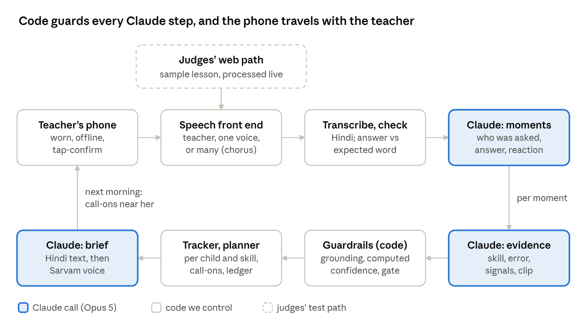
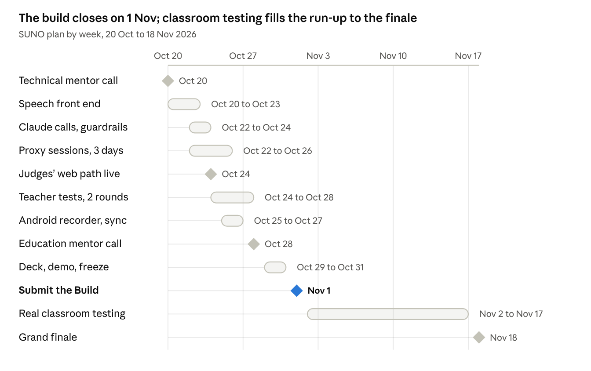

# SUNO — Build Handoff

> Offline copy of the live doc: https://claude.ai/code/artifact/5979df68-0b1e-4895-a86a-3592ee10bd2a — the live doc wins if they differ.

Oct 20, 2026 · @Tushar

Everything needed to continue SUNO on the MacBook M5 Air: where things stand, what to build by the 1 Nov deadline, every decision and fact behind it, and the two mentor calls.

## Start here: setting up the new Mac

Unzip the handoff bundle into `~/code/suno`, put both API keys in `.env`, and open the folder in Claude Code. It reads `CLAUDE.md` automatically and gets the full context from `docs/HANDOFF.md`, an export of this doc.

1. **Copy the bundle.** `SUNO_handoff_bundle.zip` was sent in the chat that made this doc; AirDrop it to the new Mac. Unzip it to `~/code/suno`. The bundle is the only copy of the deck sources and video files: the old machine's scratch workspace is deleted when that session ends.
2. **Install tools.**
   - Homebrew
   - `uv` (Python 3.12)
   - Node 22+
   - `ffmpeg`
   - Google Chrome (renders the deck PDF and the video)
   - Android Studio, for the APK
3. **Add keys to `.env`, never to git.**
   - `ANTHROPIC_API_KEY`: the hackathon key, with $500 of credits. Set a spend limit or alert in the Anthropic Console if that org allows it.
   - `SARVAM_API_KEY`: Sarvam speech-to-text and text-to-speech.

   `.env.example` lists every variable.
4. **Create the repo.** Make it a private GitHub repo. Commits from 7 Sep onward count. Make **no commits after 1 Nov, 11:59 pm**. Give Tech4Dev's evaluator IDs read access before the deadline.
5. **Brief Claude Code.** Open `~/code/suno` and start with: *"Read CLAUDE.md, docs/HANDOFF.md and docs/decisions.md, then propose today's build plan."*
6. **Report the mentor calls.** Paste your notes starting with **"Mentor call report:"**. `CLAUDE.md` tells Claude Code to:
   - log each item in `docs/decisions.md`
   - adjust the build plan
   - add the evidence to the Build deck's "User inputs and testing" list

**Links:** this doc · [Technical mentor prep](https://claude.ai/code/artifact/9058f84b-db0c-4071-813a-3291dadfc545) · [Education mentor prep](https://claude.ai/code/artifact/3130f8ca-6665-4fc8-a90b-962bf60564ab) · [Hackathon page](https://hack2skill.com/event/aiforfoundationallearning/)

## Where things stand on 20 Oct

SUNO is in the Top 30 (Build stage) for Challenge 2: Learning-Level Visibility. The idea, the deck, the concept video and the mentor prep are done. **No prototype code exists yet**, so the next 12 days are the build.

**Team Sunvai** (the name means "a hearing"):

- **Tushar:** project lead, product and engineering; came up with SUNO
- **Saikiran:** architecture and risk lead; Staff Software Engineer

There is no educator on the team. Mentors and real teacher testing cover that gap.

| Item | Status | Where |
| --- | --- | --- |
| Ideate deck (10 content slides, cover, team page) | Submitted; selected | Bundle: `assets/deck/` |
| Concept video, silent, 91 s | On YouTube: [youtu.be/e8ZQBmMNkPY](https://youtu.be/e8ZQBmMNkPY), linked from the deck | Bundle: `assets/video/` |
| Concept video with voiceover, plus subtitles | Made with the Mac's Indian-English voice, not uploaded; the Sarvam-voice version waits on the key | Bundle: `assets/video/` |
| YouTube thumbnail | Made | Bundle: `assets/video/` |
| PAHUNCH (our second Ideate idea, Challenge 3) | Submitted at Ideate; SUNO is the Build-stage project | Bundle, for reference |
| Mentor prep docs | Done | Section 12 |
| Outreach drafts: NGO email, head teacher (English and Hindi), LinkedIn, organiser messages | Drafted; the organisers already answered our group question | `docs/outreach.md` |
| Research: ASR, speaker separation, DPDP, mentor panel | Done | Sections 7 and 11 |
| Prototype code | Not started | — |
| Real children's audio | None yet | Section 9 |

| Date | What |
| --- | --- |
| Oct 20, 2026, 7:30 pm | Technical mentor call: Saurabh Deshpande, NVIDIA |
| Oct 28, 2026, 5 pm | Education mentor call: Rebecca Swittens, Madhi Foundation |
| Nov 1, 2026, 11:59 pm | Build deadline: code and deploy frozen |
| Nov 10, 2026 | Top 10 announced |
| Nov 18, 2026, 10 am – 2 pm | Grand finale, in person (venue to be announced) |

**Open actions this week:**

- [ ] Before tonight's call, if there's time: the 30-minute home distance test (section 9)
- [ ] Recruit 4–5 children aged 6–8 and an adult to teach; get parents' written consent
- [ ] Send the NGO and teacher outreach (`docs/outreach.md`)
- [ ] Save the Sarvam key, regenerate the voiceover in the Sarvam voice, and upload it. If the YouTube link changes, update the deck's Watch buttons.
- [ ] Create the repo and start the design-change log (`docs/decisions.md`)
- [ ] Download Pratham's ASER dataset (section 9)

## The rules that decide the Build score

The Build stage is scored 35% on efficacy and user-centricity, 30% on AI use and technical strength, 25% on innovation and 10% on roadmap. Reviewers verify the AI use by reading the code.

| Criterion | Weight | What reviewers look for |
| --- | --- | --- |
| Efficacy and user-centricity | 35% | Impact potential; an intuitive interface; built for user constraints (vernacular, voice-first, context); **proof of testing and refinement based on user input** |
| Effective AI use and technical strength | 30% | AI used for its strengths; technical depth, including guardrails for errors; works in real scenarios |
| Innovation | 25% | A new approach, or one never applied to this problem; clear difference from existing tools |
| Future roadmap | 10% | A credible path to development and to integration with existing systems |

**What to submit by 1 Nov, 11:59 pm:**

1. A testable hosted link, plus an APK with install steps if the app is mobile-only
2. A GitHub repo, with read access for the Tech4Dev evaluator IDs granted before the deadline
3. A public 3-minute YouTube demo. Judges need not watch past 3 minutes.
4. A short PowerPoint deck covering:
   - AI use in layers: input → processing → guardrails → evaluation → output, and where each model call happens
   - how wrong or inappropriate AI outputs are handled
   - low connectivity, low data and cheap devices: what needs a network, and what degrades gracefully offline
   - user inputs and testing (1–2 pages)
   - future roadmap (1–2 pages)

**Tech4Dev's one-hour hands-on review checks:**

- the hosted link stays live through the review window
- test credentials for every role
- 3–5 sample inputs that show the solution at its best
- a stated offline and low-network behaviour (they will test it)
- a 2–3 minute fallback video
- a frozen deploy
- a README with setup, a local run and `.env.example`
- every external AI service listed, with where keys go
- **no secrets and no real users' personal data in the repo**
- no commits after the deadline

**Other rules:**

- **Claude must be used somewhere.** The hackathon credits must cover at least one part of the solution; other models and APIs are allowed alongside.
- The work must be built during the hackathon. Commits from 7 Sep onward count.
- Open-sourcing is optional. It earns $250 in extra credits but does not affect scoring.

**The organisers' testing guidance** (their reply in the Top 30 group, mid-October):

- For teachers, students and parents, teams score favourably when they **actually reached real users and watched them use the solution**.
- For niche users (DEOs, BEOs, CRPs), domain-mentor input, and how it changed the design, is accepted.
- For data, the closest proxy is acceptable, e.g. **testing with 4–5 children of the same age group**. Showing it working in a real setting scores higher.
- Scoring accounts for what data and input could realistically be obtained.

**The finale (18 Nov)** needs a 10–12 page deck, including any on-ground testing with real data, and a live demo. Bring a pre-recorded backup. The jury:

- Rukmini Banerji (Pratham, ASER)
- Jonathan Stern (Gates Foundation)
- Mekin Maheshwari (Udhyam)
- Rahul Kulkarni (Samagra)
- Shridhar Sethuram (Suyash Advisors)
- Raahil Rai (Anthropic)
- Ishmeet Singh (Central Square Foundation)
- Piyush Prasad (IHFC, IIT Delhi)

## SUNO as promised in the Ideate deck

**SUNO (सुनो, "listen") turns the ordinary talk of a Grade 1–3 lesson into per-child learning evidence, with no tests and no extra teacher time.** The judges selected us on these promises, so the build must keep them, or say clearly what changed and why (section 5).

**The problem.** A teacher hears exactly where each child is stuck, and the system keeps none of it. Our anchor story comes from the organisers' Challenge 2 video: Priya stumbles on "tree", the teacher hears it, and it is lost.

- **76.6%** of Std III children in government schools can't read a Std II text (ASER 2024).
- Government teachers spend only **21.57%** of their time actually teaching (a NUEPA study of 28 districts in 17 states, cited by ORF).
- The only routine learning data is **two exams a year**: the half-yearly and the annual.

**How it works:**

1. **Record.** One tap; the phone records the reading or maths period offline.
2. **Separate.** The audio is split into teacher, chorus and single-child segments, then transcribed.
3. **Reconstruct.** Claude rebuilds each question–answer moment: who was called by name, what they answered, how the teacher reacted, and what the expected answer was.
4. **Accumulate.** Each moment becomes an evidence record. A child is named only after **3 or more moments over at least 2 days** agree.
5. **Brief.** Next morning, a 2-minute Hindi voice brief goes to the teacher.

**The morning brief** answers the teacher's own three questions, verbatim from the organisers' video:

- *"How many in my class of 35 children are weak at reading?"* → a count by skill, with names, worded as "needs support"
- *"How many know letters but can't blend sounds?"* → where each child sits on the skill ladder
- *"Who needs help with what?"* → today's level groups, each with one 10-minute activity from the NCERT Class 1–2 handbook

It also lists **whom to call on today**, so every child gets heard, and **evidence cards**. Each card shows the claim, a 4-second clip played from the phone, a confidence score, and ✓/✗ buttons. A low-confidence finding becomes a question ("ask Suresh to read 32 tomorrow"), never a label. A weekly **Silence Ledger** lists the children not heard individually.

**The six capabilities the deck claimed:**

- **Name-anchored attribution:** teachers call on children by name, so the roster resolves who answered
- **Chorus detection:** answers given in chorus are never counted as evidence
- **The Silence Ledger:** worked out in code, with no AI
- **The teacher's reaction as ground truth:** praise or correction, in the teacher's clear adult voice
- **Calibrated humility:** a confidence gate, and questions instead of labels
- **The language-or-concept flag:** now moved to the roadmap

The "follow one moment" slide added a sixth step: **fill the gaps on purpose**, by suggesting whom to call on.

**Non-negotiables the build must keep:**

- [ ] No teacher score, and no teacher field anywhere in the data model
- [ ] No child described as "weak", "slow" or "poor". The language is "needs support".
- [ ] First names only; no photos or video of children
- [ ] Playback clips stay on the teacher's phone
- [ ] Recording works fully offline; no device for any child
- [ ] A confidence gate (0.75 proposed), and every claim tied to its audio evidence
- [ ] The 3-moments / 2-days naming rule
- [ ] Silence Ledger worked out in code, with no AI
- [ ] Claude used at the core: Opus 5 with structured outputs

**Validation we promised (E1–E6):**

- E1: agreement with ASER DIY
- E2: beating the teacher's own recall
- E3: attribution precision of 85% or more
- E4: experts agreeing with SUNO's error diagnoses
- E5: confidence that matches reality
- E6: under 3 minutes of teacher time a day

Section 9 says which of these we can realistically deliver.

## Design decisions since the Ideate deck

The biggest change is that **the phone moves from the desk to the teacher**, and the moments that matter are brought within a metre of it. Rows marked Proposed wait on the mentor calls or the distance test; flip them to Decided as they are confirmed.

| # | Decision | Why | Source | Status |
| --- | --- | --- | --- | --- |
| 1 | The teacher **wears the phone** on a lanyard or in a shirt pocket; the desk is only a fallback | Sound loses 6 dB each time distance doubles. An answer at about 60 dB one metre away is about 44 dB at six metres, likely below classroom noise. | Distance analysis, 20 Oct | Proposed |
| 2 | **Evidence moments come to the mic.** The daily call-ons happen near the teacher: one word read at her desk, or her leaning in at the bench. | Clear audio for the moments that matter. This is ordinary teaching, not a test. | 20 Oct | Proposed |
| 3 | An optional **one-tap confirm** of which child is reading, during planned call-ons | Removes doubt about who spoke where it matters most | 20 Oct | Proposed |
| 4 | **Precision over recall.** Claim only what was heard clearly, and publish the measured operating range. | A wrong label is the worst failure; "not enough evidence yet" is acceptable | 20 Oct | Decided |
| 5 | **No full speaker separation.** Classify only: teacher, one other voice, or many. | Classroom teacher-vs-student separation error is 17–45%, even when tuned (arXiv 2505.10879) | Research, 15 Oct | Proposed |
| 6 | Check each answer **against the expected word**, rather than transcribing freely | No published results for Hindi child speech; free transcription is too fragile | Research, 15 Oct | Proposed |
| 7 | ASR: Sarvam Saaras (API) or AI4Bharat IndicConformer (open weights), **not Whisper** | Vaani benchmark error: 19.5% and 20.0%, versus 32.8% for Whisper, which collapses in noise | Research, 15 Oct | Proposed |
| 8 | Cadence: **every child heard within a week**, first named conclusions after about two weeks | A realistic count of clear moments per child | 20 Oct | Decided |
| 9 | MVP scope: Hindi, Grade 2, reading (letters → vowel marks → blending → words), with English words second (the organisers' "tree" example) | 12 days, 2 people | 15 Oct | Proposed |
| 10 | Moved to roadmap: the language-or-concept flag, numeracy, on-device processing, a mentor view | Scope | 15 Oct | Decided |
| 11 | The judges' path processes a sample lesson **live**, with direct Claude calls; Message Batches only for bulk evaluation | Batches can take hours, and judges have one | 15 Oct | Decided |
| 12 | **The school or state owns the data**; SUNO acts as its processor | The DPDP exemption covers educational institutions, not vendors | Research, 15 Oct | Decided |
| 13 | Cost per child corrected from ≈₹110 to **≈₹210 a year**, adding Sarvam ASR at about ₹18 per lesson | The deck counted Claude only | 15 Oct | Decided |
| 14 | Deck wording: "phone on the teacher's desk" → "worn by the teacher"; "zero assessment events" → "no tests, no extra time" | Keeps the deck consistent with rows 1 and 2 | 20 Oct | Proposed |
| 15 | Real-user testing: proxy sessions with 4–5 children over 3 days, plus 3 teachers in 2 rounds | The organisers' guidance | 16 Oct | Decided |

## Architecture and build spec

SUNO is a speech front end we control, three Claude calls, and code-based guardrails, tracker and planner. The front end decides whether it works at all, so build and measure it first.

&#91;embedded content: SUNO build architecture · 8 stages, 3 Claude calls\]



Read it clockwise from the teacher's phone. Claude never sets confidence and never speaks to the teacher unchecked: code sits between every Claude step and the teacher.

### Components

| # | Component | What it does | Tech |
| --- | --- | --- | --- |
| 1 | Teacher app (Android) | Roster from a photo of the attendance register (Claude reads the names) or typed in; one-tap record; brief screen with Hindi voice; evidence cards with clip playback and ✓/✗; optional tap-to-confirm the child during planned call-ons. Works offline. | Kotlin or React Native (ask the mentor, T10) |
| 2 | Web app | The judges' path and a teacher web view: a login per role, sample lessons, audio upload, processing status, the brief and cards, an evaluation page | React/Next.js on a host such as Vercel, Render or Fly |
| 3 | API and jobs | Upload, processing jobs, storage | FastAPI (Python 3.12), Postgres with pgvector, a job-table worker |
| 4 | Speech front end | Speech detection; teacher vs. not-teacher (checked against a 30-second voice enrolment); one voice vs. many (chorus); optional noise cleaning | Silero VAD, SpeechBrain ECAPA, pyannote overlap detection or an energy heuristic, DeepFilterNet (test first) |
| 5 | ASR | Hindi and code-mixed transcription, with timestamps and a segment ID per utterance | Sarvam Saaras, or IndicConformer run locally |
| 6 | Names and answers | Finds roster names in the teacher's speech (fuzzy and phonetic matching); checks a child's answer against the expected word | Python; forced alignment if time allows |
| 7 | Claude ① | Rebuilds question–answer moments | Claude Opus 5 |
| 8 | Claude ② | Turns moments into evidence records | Claude Opus 5 |
| 9 | Guardrails | Grounding check, schema check, confidence formula and gate, banned words | Python |
| 10 | Tracker, planner, Silence Ledger | Per-child skill beliefs, tomorrow's call-ons, unheard children | Python |
| 11 | Claude ③ and voice | Writes the morning brief in Hindi, then speaks it | Claude Opus 5, Sarvam bulbul:v3 (hi-IN) |
| 12 | Evaluation harness | Reproduces every number in the deck from labelled data | Python, with CSV labels |

### Data model (Postgres)

- `schools`, `classes`, `children` (first name, aliases, roster ID): no surnames, no photos
- `teachers` (login and voice enrolment only): **no performance fields of any kind**
- `lessons`: class, date, duration, skill focus, expected items from the textbook page; raw audio stays out of the database
- `segments`: lesson, start/end time, speaker type (teacher, single, many, unknown), text, ASR confidence
- `moments` and `evidence`: see the schemas below
- `skill_state`: child, skill, alpha, beta, last update
- `briefs`, `feedback` (the teacher's ✓/✗), `consents` (per child, with date and scope)

### The three Claude calls

All three use `claude-opus-5` with adaptive thinking and JSON-schema structured outputs. The roster, skill taxonomy and NCERT activity text are cached as a shared prompt prefix. The judges' path uses direct calls; Message Batches (half price) are for bulk evaluation only.

1. **① Rebuild moments.**
   - **In:** segments `[{seg_id, t0, t1, speaker, text, asr_conf}]`, the roster `[{child_id, first_name, aliases}]`, and lesson context (expected items, skill focus).
   - **Out:** `moments[]`, each with:
     - `moment_id`, `prompt_seg_ids`, `response_seg_ids`
     - `addressee_child_id` (nullable) and `attribution_basis`: `name_call`, `tap_confirm` or `none`
     - `response_type`: `individual` or `chorus`
     - `expected_item`
     - `teacher_uptake`: `praise`, `correction`, `repeat`, `neutral` or `none`
     - `teacher_said_answer` (bool)
2. **② Extract evidence.**
   - **In:** the moments and the skill taxonomy.
   - **Out:** `evidence[]`, each with:
     - `moment_id`, `child_id`, `skill_code`
     - `outcome`: `correct`, `incorrect`, `partial` or `unclear`
     - `error_type`
     - `signals {expected_match, uptake, teacher_said_answer, attribution}`
     - `segment_ids` and a one-line `rationale`

   **Claude does not produce the confidence score; code computes it from the signals.**
3. **③ Write the brief.**
   - **In:** tracker state, the week's evidence summary, the call-on plan, and NCERT activities found by retrieval.
   - **Out:** `{needs_support[], stuck_where[], today[{group, child_ids, activity_id, minutes}], call_on[], silent[], text_hi}`.

   It passes the banned-words check, then goes to text-to-speech.

An example evidence record (synthetic):

```json
{"child":"Priya","skill":"decoding.blending_CCVC","item":"tree",
 "outcome":"incorrect","error":"segments_without_blending",
 "signals":{"expected_match":0.31,"teacher_uptake":"correction","teacher_said_answer":true},
 "attribution_conf":0.93,"overall_conf":0.84,"audio":"10:14:32-10:14:43"}
```

### Guardrails (in code, and tested)

- **Grounding:** every moment and every piece of evidence must cite segment IDs that exist in that lesson, and any quoted text must match. Otherwise it is dropped.
- **Strict schema:** unknown fields are rejected.
- **Confidence is computed, not asked for.** Combine attribution certainty, answer match, teacher reaction and whether the teacher said the answer, using hand-set weights at first, then calibrate on labelled data. **Gate: 0.75.** Below it, a claim becomes a question for tomorrow.
- **Banned words**, in English and Hindi (weak, slow, poor, कमज़ोर, कमजोर, ढीला): any match means the brief is rewritten.
- **Adversarial test cases in the repo:**
  - two children with the same name
  - the teacher praising a wrong answer
  - a child answering for a friend
  - chorus only
  - noise only
  - a name with no answer

### Tracker, planner and Silence Ledger

- **Tracker:** a Beta(α, β) belief per child and skill, starting at 1, 1. Each piece of evidence with confidence *c* updates it:
  - correct: α += *c*
  - incorrect: β += *c*
  - partial: half of *c* to each

  Evidence older than two weeks counts less. A child is marked **needs support** when P(skill) < 0.5 and **on track** when it is > 0.7, but only with at least 3 moments over at least 2 days. Anything else is **not enough evidence**.
- **Planner:** each morning it picks up to 3 children with the fewest confident moments on this week's skills, mixing those needing support with those who are simply unheard. It never picks the same child two days running. Its instruction: "at your desk, one word each from page X".
- **Silence Ledger:** the roster minus every child with at least one individual moment in the last 5 school days, excluding absent children when attendance is known. Worked out in code, with no AI.

### Offline behaviour

- **Works offline:** recording, storage, the last brief, clip playback, and queued ✓/✗.
- **Needs a network:** the upload (about 4 MB per 35-minute lesson at 16 kbps Opus) and the brief download (about 10 KB).
- A Wi-Fi-only switch keeps data costs on the teacher's own plan under ₹2 a month.

## Tech stack and verified API facts

Claude Opus 5 does the reasoning, Sarvam handles speech in and out, and open models handle separating voices. Facts below were checked on 15–20 Oct; re-check prices and limits before relying on them.

### Claude (the $500 hackathon key)

| Model | ID | Price per million tokens (input / output) | Use in SUNO |
| --- | --- | --- | --- |
| Claude Opus 5 | `claude-opus-5` | $5 / $25 | Default for all three calls |
| Claude Sonnet 5 | `claude-sonnet-5` | $2 / $10 | A cheaper option if a step proves easy |
| Claude Haiku 4.5 | `claude-haiku-4-5` | $1 / $5 | Light formatting only |

- **Thinking:** use `thinking: {type: "adaptive"}`. `budget_tokens` is rejected on Opus 5. Control depth with `output_config: {effort: …}`, which defaults to high.
- **Structured outputs:** `output_config: {format: …}`, or `client.messages.parse()` with a schema. The old `output_format` parameter is deprecated.
- **No assistant prefill on Opus 5.** Use structured outputs instead.
- **Message Batches:** half price, but asynchronous, and results can take hours. Use them for bulk evaluation, never on the judges' live path.
- **Prompt caching:** put the roster, taxonomy and NCERT text first in the prompt as a stable prefix. Check `usage.cache_read_input_tokens` to confirm it is working.
- **Citations** don't work together with structured outputs in the same call.
- **Refusal fallbacks:** the Claude API skill recommends the server-side `fallbacks` parameter (beta) for Opus 5. Ask Claude Code to add it.
- **Budget:** about 30K input and 12K output tokens per lesson is roughly $0.45, so $500 covers about 1,100 lesson runs. Development and evaluation should use well under half of that.

### Speech

| Tool | What it does | Facts |
| --- | --- | --- |
| [Sarvam speech-to-text](https://docs.sarvam.ai) (Saaras v3/v4) | Hindi and Hinglish ASR | ₹30 per audio hour (₹45 with diarization); REST takes ≤30 s per request, Batch takes long files; code-mix mode; the docs conflict on word-level timestamps, so test before relying on them. Starter limits: 60 REST requests a minute. |
| [Sarvam text-to-speech](https://docs.sarvam.ai/api-reference/text-to-speech/convert) (bulbul:v3) | Brief voice and video voiceover | `POST https://api.sarvam.ai/text-to-speech`, header `api-subscription-key`. Body: `text` (max 2,500 characters), `language_code` (`hi-IN` or `en-IN`), `model`, `speaker` (`shubh` by default; others include `kavya`, `ritu`, `aditya`, `priya`), `pace` 0.5–2.0, `temperature`, `speech_sample_rate` up to 48 kHz. Response: `audios[]` in base64. |
| [AI4Bharat IndicConformer-600M](https://huggingface.co/ai4bharat/indic-conformer-600m-multilingual) | Local Hindi ASR | MIT licence, gated download. 20.0% error on Vaani (adult phone speech); only 3.7 points worse in heavy noise. No timestamps documented. |
| Whisper large-v3 | — | 32.8% error on Vaani, and 34 points worse in heavy noise. **Avoid.** |
| Google Chirp 3 | Backup ASR | 22.5% on Vaani; $0.016 a minute; word timestamps cost accuracy |
| Bhashini | Government ASR and TTS | Needs registration and approved keys; rate limits and the model behind it are undocumented |
| [pyannote community-1](https://huggingface.co/pyannote/speaker-diarization-community-1) | Overlap and chorus detection | CC-BY-4.0, gated. Off the shelf, classroom teacher-vs-student error is 33–45%. |
| NVIDIA NeMo | Diarization alternative | Teacher-vs-student error of 27–37% off the shelf; Sortformer handles at most 4 speakers |
| [SpeechBrain ECAPA](https://huggingface.co/speechbrain/spkrec-ecapa-voxceleb) | Teacher voice check | 9–10% error in real classrooms pretrained, about 5% after fine-tuning |
| Forced alignment | Answer checking | `torchaudio.forced_align` was removed in 2.9. MMS-FA needs romanised Devanagari (uroman). |
| pyroomacoustics, DeepFilterNet | Room simulation, noise cleaning | Open source; test before relying on them |

**Running cost** per 35-minute lesson: Claude ≈ $0.45 at list price (≈ $0.23 batched), plus Sarvam ASR ≈ ₹18. That comes to about ₹210 per child per year (35 children, 200 lessons).

## Build plan to 1 Nov

Build the riskiest part first, the speech front end on real audio. Get a working judges' path by 24 Oct, and stop building on 31 Oct. A suggested split: Tushar takes the app, the brief and user testing; Saikiran takes the speech pipeline, guardrails and evaluation.

&#91;embedded content: SUNO plan · 20 Oct to 18 Nov 2026\]



The proxy sessions and teacher tests run alongside the build, not after it. Their findings have to reach the code by 29 Oct.

- [ ] **20 Oct**
  - Technical mentor call, 7:30 pm
  - Create the repo from the bundle
  - Home distance test (section 9)
  - Download the ASER dataset
  - Save the Sarvam key
- [ ] **21 Oct**
  - Speech front end v0 on home recordings and ASER clips: speech detection, teacher check, one voice vs. many, Sarvam ASR
  - Answer-checker on the ASER dataset: **the first real accuracy number**
- [ ] **22 Oct**
  - Claude ① and ② with schemas
  - Guardrails: grounding, confidence formula, gate
  - Proxy session 1 with children, recorded on two phones
- [ ] **23 Oct**
  - Tracker, planner and Silence Ledger
  - Claude ③ brief with Sarvam voice
  - Proxy session 2
- [ ] **24 Oct**
  - The judges' web path live: sample lesson or upload → brief
  - Teacher test, round 1
- [ ] **25 Oct**
  - Android recorder: foreground service, one-minute chunks, upload queue
  - Fixes from teacher round 1
- [ ] **26 Oct**
  - Proxy session 3
  - Label all sessions
  - Evaluation harness: attribution precision and answer accuracy by distance
- [ ] **27 Oct**
  - Connect the app to the backend
  - Offline behaviour
  - Brief screen and evidence cards in the app
- [ ] **28 Oct**
  - Education mentor call, 5 pm, opening with a live demo
  - Teacher test, round 2
- [ ] **29 Oct**
  - Fixes from round 2 and both mentors
  - Final evaluation numbers
  - README, `.env.example`, adversarial tests
- [ ] **30 Oct**
  - Build deck: AI layers, guardrails, offline behaviour, user testing, roadmap
  - Record the 3-minute demo
- [ ] **31 Oct**
  - Deploy and freeze
  - Test logins for every role
  - 3–5 sample inputs
  - Grant Tech4Dev repo access
  - A full rehearsal of the judges' path on a throttled network
- [ ] **1 Nov:** submit by early afternoon, not at 11:59 pm. **No commits after the deadline.**
- [ ] **2–17 Nov**
  - Real classroom testing for the finale
  - The 10–12 page finale deck
  - A live demo, with a recorded backup

If a day slips, protect this order: the speech front end on real audio, then the judges' path, then teacher testing, then the Android app. A web demo plus recorded proxy sessions beats a half-finished app.

## Data and evaluation plan

We'll have real child speech from three sources by 27 Oct: Pratham's ASER recordings, a home distance test, and three proxy sessions with 4–5 children. We commit to three evaluations we can actually finish, and they answer the biggest doubt directly: **can the phone hear the children who matter?**

### Data sources

| # | Source | What it is | Used for | When |
| --- | --- | --- | --- | --- |
| 1 | [ASER dataset](https://github.com/PrathamOrg/ASER-Dataset) | 5,301 recordings of children aged 6–14 reading Hindi, Marathi and English, labelled right/wrong with mistake counts (CC BY-NC-SA 4.0) | Testing the answer-checker on real child speech | Now |
| 2 | [HiACC](https://zenodo.org/records/15551669) | 2 hours of Hinglish child speech, recorded on a phone in a school (CC BY-NC 4.0) | ASR sanity check on children | Optional |
| 3 | Home distance test | Adults reading Hindi words at 1, 2, 4 and 6 m, desk phone vs. worn phone | First numbers, for the mentor call | 20 Oct |
| 4 | Proxy sessions | 4–5 children aged 6–8, three days, two phones | The main real dataset, the distance study, and a brief for the teacher | 22–26 Oct |
| 5 | Role-play lessons | Scripted full lessons with adults, labelled | The judges' sample inputs | 21–24 Oct |
| 6 | Synthetic lessons | Text-to-speech dialogues | Pipeline tests only; always labelled synthetic | Any time |
| 7 | Simulated classroom | Real clips placed in a simulated 35-child room (pyroomacoustics plus chatter) | Scaling results to full-class noise; labelled as simulation | 26–29 Oct |
| 8 | Real classroom | A partner school | The finale's on-ground testing | 2–17 Nov |

No public Indian classroom audio exists; NCTE, the largest classroom set, is US transcripts only. **Real recordings stay in `data/raw/`, which git ignores, with a consent record for each child.**

### The distance experiment

1. **Room:** the largest available, with a fan running and natural chatter, or classroom noise played at a moderate volume.
2. **Seating:** children at 1, 3 and 5 m from the desk phone (front, middle and back rows).
3. **Phones recording together:**
   - A, on the desk
   - B, worn by the teacher on a lanyard
   - C, optional, near the children as a clean reference for labelling
4. **Lesson:** the adult teaches a Grade 2 Hindi textbook page as normal. She calls each child by name to read a word or line, allows some chorus reading, and reacts naturally, for about 15 minutes. Don't script the children's answers.
5. **Labelling:** a second adult notes who spoke and whether they were right, or it is labelled later from phone C.
6. **Repeat on three different days.** SUNO's naming rule needs at least two days.
7. **On day 1,** run the free ASER DIY test one-to-one with each child, as the ground-truth reading level.

**The output:** a chart of accuracy by distance and phone placement, and a plain sentence on the reliable range. For example: "reliable within about 2 m of the teacher in this noise".

**The 30-minute home version, for today:**

- In your largest room, put one phone on a table and one in your pocket, with classroom noise playing.
- Someone reads the same 10 Hindi words from a Grade 2 page at 1, 2, 4 and 6 m. Make each distance its own recording of 30 seconds or less.
- Call the reader's name before each set, and react ("shabaash", "phir se").
- Transcribe with Sarvam and score the words recognised per distance, for each phone.

### Labelling schema (CSV, one row per moment)

```csv
lesson_id,t_start,t_end,speaker,distance_m,phone,expected_item,heard_human,correct,skill_code,error_type,teacher_uptake,notes
proxy-d1,00:03:12,00:03:16,child:Priya,3,worn,पेड़,पे-ड़,partial,read.blend_cvc,segments_without_blending,correction,
```

### The evaluations we commit to

This set is proposed; confirm it with the technical mentor.

| # | Question | Method | Bar |
| --- | --- | --- | --- |
| A (E3) | Does SUNO know who spoke? | Attribution precision on labelled moments, by distance and phone placement | 85% or more at the gate |
| B (new) | Can it tell right from wrong? | Right/wrong accuracy against human labels, on ASER clips and the proxy sessions, by distance | Report it honestly, and state the reliable range |
| C (E1) | Is it right about each child? | SUNO's level per child vs. the ASER DIY level, for the proxy children | Counts, not κ: the sample is too small for statistics |

**Stretch goals:**

- E5, confidence calibration, needs at least 200 labelled moments.
- E6, teacher minutes a day, comes from the teacher tests.
- E2, beating the proxy teacher's own estimate.

**Deferred:** E4, expert coding of errors, unless an FLN expert offers to help.

Every number comes from a script in the repo, with counts and intervals, and is published even when it disappoints.

## Testing with real users

The organisers score real contact with teachers, children and parents, and the changes it caused. Plan for three proxy sessions with children, two rounds with three teachers, and a design-change log that becomes the "User inputs and testing" slide.

### Children: proxy sessions

Run these as described in section 9: 4–5 Hindi-speaking children aged 6–8, one adult teaching (ideally a real primary teacher), three sessions on three days, two phones.

- Get **parents' written consent** and each child's own okay, before any recording.
- After each session, run SUNO and give the teacher her morning brief the next day. **Watch what she does with it.** That is the strongest evidence we can have.
- In the deck, describe it plainly: *"Proxy test: 5 children aged 6–8, three sessions, recorded at home with parents' written consent."* Also say that 5 children are easier to tell apart than 35.
- Keep real children's voices out of anything public, including the YouTube demo.

### Teachers: two rounds, three teachers each

Each session is 20 minutes, using a brief from a proxy session or a role-play lesson. Take notes; record audio only with consent. Give the teacher five tasks:

1. "Listen to this brief. What will you do tomorrow?"
2. "Which children need help with blending?"
3. "Open Priya's card. Do you agree? Tap ✓ or ✗."
4. "Who would you call on today, and how?"
5. "Would you record your class with this? What would worry you?"

**Observation sheet:**

| Teacher (anonymised) | Task | Done? | Time taken | Where they hesitated | What they said | Change we'll make |
| --- | --- | --- | --- | --- | --- | --- |
| T1 | 1 |  |  |  |  |  |

Round 1 runs on 24 Oct. Fix the top 2–3 problems, then run round 2 on 28 Oct, with the same teachers where possible, so the deck can show before and after.

### Parents

The consent conversation is user input too. Note what parents ask and worry about, and what made them say yes or no. It shapes SUNO's privacy design and the onboarding script.

### Mentors and organisers

For niche users (CRPs, BEOs), the organisers accept mentor input, if we show how it changed the design. Log every mentor answer that changes something.

### Design-change log

This table is the evidence slide. It is kept in `docs/decisions.md` in the repo.

| Date | Source | What they said or did | What we changed | Where it shows |
| --- | --- | --- | --- | --- |
| \~16 Oct | Organisers (Top 30 group) | Proxy testing with 4–5 children is acceptable; real users and real settings score higher | Added three proxy sessions and two teacher rounds to the plan | Build plan; this section |

### Outreach status

The drafts are in `docs/outreach.md`:

- an NGO email
- a head-teacher message in English and Hindi
- a LinkedIn note of 278 characters
- a question for the Top 30 group, which the organisers answered
- a private message to one organiser asking for introductions (send status unknown)

**Still to do:** a parent consent form (Hindi and English), a session plan, and the teacher test script as a printable sheet.

## Privacy, consent and safety

SUNO records children, so it needs parents' consent and a design in which the school owns the data and SUNO only processes it. The binding DPDP rules arrive around May 2027, but judges and partners will expect the design now. This is our reading, not legal advice.

**The law, as researched on 15 Oct:**

- The [DPDP Act](https://www.meity.gov.in/static/uploads/2024/06/2bf1f0e9f04e6fb4f8fef35e82c42aa5.pdf), Section 9:
  - 9(1): verifiable parental consent before processing any child's data
  - 9(2): no processing likely to harm a child's well-being
  - 9(3): no "tracking or behavioural monitoring of children"

  A child is anyone under 18. Voice recordings and per-child inferences count as personal data.
- The [DPDP Rules](https://www.meity.gov.in/static/uploads/2025/11/53450e6e5dc0bfa85ebd78686cadad39.pdf) (G.S.R. 846(E), 13 Nov 2025): Rule 12 and Fourth Schedule item 3 exempt an **educational institution** from 9(1) and 9(3), but only for tracking and monitoring for its educational activities or children's safety. 9(2) still applies. **The exemption covers the school, not a vendor**, so SUNO is the school's or state's processor under a contract.
- **Timing:** Section 9 and Rules 3 and 5–16 take effect around 13 May 2027.
- **Retention:** Rule 8(3) asks for at least a year's retention of data and logs, for state access. It is unclear how that fits with deleting audio straight after transcription. Plan to keep transcripts and logs, and delete raw audio.
- **Research exemption:** it doesn't apply, because SUNO makes decisions about individual children.
- **Cross-border transfers:** Section 16 works as a blocklist, and no countries were listed at the time of the research.
- **State rules:**
  - Rajasthan (16 Aug 2026) and an Ayodhya, UP block order (19 Aug 2026) require the principal's prior written permission for any outsider's audio recording.
  - The Supreme Court dismissed a challenge to both on 1 Sep 2026.
- **Precedent:** Wadhwani AI's [Vaachan Samiksha](https://www.wadhwaniai.org/vaachan-samiksha-leveraging-ai-to-bridge-the-literacy-divide/) records children reading on teachers' phones in about 30,000 Gujarat schools. How it handles consent isn't public.

**Our design commitments:**

- [ ] Consent per child before any recording: parents in writing, plus the child's own okay. Proxy sessions get a short form; schools get the head teacher's written permission plus a School Management Committee consent meeting.
- [ ] First names only; no surnames, photos or video; roster IDs in every model output
- [ ] Audio encrypted in transit, and deleted from the server after transcription; transcripts and logs kept per the retention decision
- [ ] Playback clips stay on the teacher's phone
- [ ] Data kept separate per school; audit logs of who accessed what
- [ ] No model training on children's audio
- [ ] No teacher score, and no supervisor view in V1
- [ ] Banned-label filter on everything the teacher sees
- [ ] **The repo holds no real audio, names or consent forms.** `data/raw/` is git-ignored, and a secret scan runs before the freeze.

## Mentor calls

There are two 30–40 minute calls. Each has a full prep doc with every question laid out as problem, plan, and what we need. Report each call to Claude Code using the template below.

|  | Technical | Education |
| --- | --- | --- |
| Mentor | **Saurabh Deshpande**, Head of AI Research, NVIDIA | **Rebecca Swittens**, Senior Manager FLN, Madhi Foundation (Tamil Nadu's state FLN mission) |
| When | Oct 20, 2026, 7:30 pm | Oct 28, 2026, 5 pm, four days before the deadline |
| Prep doc | [Technical mentor prep](https://claude.ai/code/artifact/9058f84b-db0c-4071-813a-3291dadfc545) | [Education mentor prep](https://claude.ai/code/artifact/3130f8ca-6665-4fc8-a90b-962bf60564ab) |
| Open with | Two worries: whether the phone can hear and attribute children at a distance, and getting real data in time | A 5-minute live demo of the prototype and a real brief |
| Ask first | **T3** (ASR engine and answer checking), **T4** (separating teacher, chorus and one child), **T1** (the judges' test path), **T7** (scope) | **E2** (does real lesson talk hold the evidence?), **E7** (the brief), **E6** (what convinces this jury), **E11** (who adopts SUNO) |
| Leave with | Decisions on ASR, voice separation, the evaluation set and scope | Classroom introductions for 1–18 Nov, a consent approach, and the brief format |

**Extra questions for Saurabh**, on the two worries:

1. Can one phone mic hear a child 5–7 m away in a noisy classroom well enough for Hindi ASR? What signal-to-noise ratio do Sarvam or IndicConformer need?
2. Teacher-worn or desk: how bad is clothing rustle? Can a phone's two mics, recorded in stereo, tell which direction a voice came from?
3. Which noise cleaning helps distant child speech without hurting recognition: NVIDIA's tools or DeepFilterNet?
4. Would he trust a simulated-room result if it were validated on a small real set? How should the distance experiment be designed?

**How to report a call to Claude Code on the new Mac.** Paste this, filled in:

```markdown
Mentor call report:
- Mentor / date:
- Q-ID (e.g. T3) — what they said — our decision — design change (if any)
- Q-ID — ...
- Introductions or offers they made:
- New risks they raised:
- Follow-ups we promised:
```

`CLAUDE.md` tells Claude Code to:

1. add each design change to `docs/decisions.md`, with the date and source
2. update section 5's status column and the build plan
3. add the evidence to the Build deck's "User inputs and testing" list

## Risks, ranked

The top three are all about audio. Measure them in the first week, so there is time to change the design while it still matters.

| Rank | Risk | What could happen | Mitigation |
| --- | --- | --- | --- |
| 1 | The phone can't hear or attribute children at a distance | Wrong or missing evidence about real children | Phone worn by the teacher; call-ons brought near her; optional tap-to-confirm; precision over recall; a measured, published range |
| 2 | Hindi recognition of children's speech is weak | Misheard answers | Lean on the teacher's reaction; check answers against the expected word; confidence gate; test on the ASER dataset first |
| 3 | Separating teacher, chorus and one child fails (17–45% error in research) | The wrong child is credited or flagged | No full diarization; teacher voice enrolment; name-call timing; drop ambiguous moments |
| 4 | No real data or users by 1 Nov | A weak efficacy score (35%) | ASER dataset now; three proxy sessions; two teacher rounds; outreach this week |
| 5 | Judges can't test SUNO in their one-hour review | A weak technical score (30%) | A live web path with sample lessons, a login for every role, and a slow-network rehearsal |
| 6 | Too much scope for 12 days | Nothing works end to end | Protect the order: speech, then the judges' path, then teachers, then the app. Web before Android. |
| 7 | Confidence scores aren't calibrated | Named children are wrong | Confidence computed in code; a gate; teacher ✓/✗; calibration if the data allows |
| 8 | Claude misreads or invents a moment | Made-up evidence | Grounding checker; strict schemas; adversarial tests in the repo |
| 9 | Consent or children's-data problems | Bad optics, legal exposure, disqualification | Written consent; the school-as-owner model; no real data in the repo; no children's voices in public material |
| 10 | A cheap Android phone kills the recording | Lost lessons | Foreground service, one-minute chunks, resumable upload |
| 11 | The live finale demo fails on stage | A lost finale | A recorded backup and an offline sample lesson |
| 12 | The Claude credits run out | Development stalls | Batches for evaluation, prompt caching, Sonnet 5 for easy steps, weekly spend checks |

## Files, links and the handoff bundle

The bundle is the only copy of the deck sources, videos and scripts; the machine where they were made deletes them when that session ends. Keep the zip somewhere safe.

**Links:**

- [Hackathon page](https://hack2skill.com/event/aiforfoundationallearning/), which has the mentor panel and the jury
- Organiser documents on Google Drive: [Guidelines](https://drive.google.com/file/d/11kMcaqI4ZZ5wcYrAg1FAMoGBXMjBZ3K0/view) · [Key messages per challenge](https://drive.google.com/file/d/1hB_R3s_s81faa8MJW2gH0ZAcetG_HGPF/view) · [Tech evaluation guidance](https://drive.google.com/file/d/1x923Tk-tzi1iLN6lHwUCnT-rAJYBYuPj/view)
- The concept video, silent, linked from the deck: [youtu.be/e8ZQBmMNkPY](https://youtu.be/e8ZQBmMNkPY)
- Prep docs: [Technical mentor](https://claude.ai/code/artifact/9058f84b-db0c-4071-813a-3291dadfc545) · [Education mentor](https://claude.ai/code/artifact/3130f8ca-6665-4fc8-a90b-962bf60564ab)

**What's inside `SUNO_handoff_bundle.zip`** (it unzips to `suno/`):

```text
suno/
├── CLAUDE.md                 ← Claude Code reads this first: context, hard rules, how to log mentor reports
├── README.md                 ← what's where, setup steps
├── .gitignore                ← keeps real audio, data, .env and assets/ out of git
├── .env.example              ← ANTHROPIC_API_KEY, SARVAM_API_KEY, DATABASE_URL
├── docs/
│   ├── HANDOFF.md            ← an export of this doc
│   ├── decisions.md          ← the design-change log (the evidence slide)
│   ├── mentor-calls.md       ← both calls, the extra questions, the report template
│   └── outreach.md           ← every outreach draft (English and Hindi)
├── data/
│   ├── README.md             ← where datasets and recordings go (raw/ is git-ignored)
│   └── labels_template.csv   ← the labelling schema from section 9
└── assets/                   ← git-ignored by default (team photos, videos)
    ├── deck/                 ← Ideate decks: HTML/CSS sources, PDFs, render scripts, logo, team photos
    │   └── video/            ← walkthrough animation source, frame-capture script, MP4s, subtitles,
    │                           thumbnail, vo/make_vo.py (the Sarvam voiceover pipeline)
    ├── submission/           ← the Ideate form descriptions (descriptions.txt)
    └── reference/            ← the organisers' PDFs (guidelines, key messages, tech guidance)
```

**Rebuilding things on the new Mac:**

- **Deck PDF:** run `assets/deck/render.sh suno`. It needs Chrome and Poppler (`brew install poppler`).
- **Video frames:** run `node capture.mjs frames 24` in `assets/deck/video/`, then encode with ffmpeg (the command is in the README).
- **Voiceover:** with `SARVAM_API_KEY` set, run `python3 assets/deck/video/vo/make_vo.py`. It times each line to its scene and writes the MP4 and SRT.

## Sources

**Hackathon**

- [Hackathon page, mentor panel and jury](https://hack2skill.com/event/aiforfoundationallearning/)
- [Guidelines](https://drive.google.com/file/d/11kMcaqI4ZZ5wcYrAg1FAMoGBXMjBZ3K0/view)
- [Key messages](https://drive.google.com/file/d/1hB_R3s_s81faa8MJW2gH0ZAcetG_HGPF/view)
- [Tech evaluation guidance](https://drive.google.com/file/d/1x923Tk-tzi1iLN6lHwUCnT-rAJYBYuPj/view)

**Problem evidence**

- [ASER 2024 summary](https://www.insightsonindia.com/2025/01/29/aser-report-2024/)
- [NUEPA teacher time-use study, via ORF](https://www.orfonline.org/research/using-ai-to-protect-teaching-time-and-improve-learning-quality-in-indian-schools)
- [J-PAL on Teaching at the Right Level](https://www.povertyactionlab.org/case-study/teaching-right-level-improve-learning)
- [DIY ASER (DIYA)](https://asercentre.org/do-it-yourself-aser-diya/)

**Speech technology**

- [Vaani Hindi ASR benchmark](https://arxiv.org/abs/2606.21408)
- [Classroom diarization study](https://arxiv.org/abs/2505.10879)
- [Classroom speaker verification](https://arxiv.org/abs/2505.20222)
- [IndicConformer](https://huggingface.co/ai4bharat/indic-conformer-600m-multilingual)
- [pyannote community-1](https://huggingface.co/pyannote/speaker-diarization-community-1)
- [SpeechBrain ECAPA](https://huggingface.co/speechbrain/spkrec-ecapa-voxceleb)
- [Sarvam docs](https://docs.sarvam.ai)
- [Sarvam TTS API reference](https://docs.sarvam.ai/api-reference/text-to-speech/convert)
- [ASER dataset](https://github.com/PrathamOrg/ASER-Dataset)
- [HiACC](https://zenodo.org/records/15551669)
- [Child-speech fluency limits](https://arxiv.org/pdf/2505.19671)

**Privacy and law**

- [DPDP Act](https://www.meity.gov.in/static/uploads/2024/06/2bf1f0e9f04e6fb4f8fef35e82c42aa5.pdf)
- [DPDP Rules 2025](https://www.meity.gov.in/static/uploads/2025/11/53450e6e5dc0bfa85ebd78686cadad39.pdf)
- [Supreme Court dismisses challenge to the UP and Rajasthan school rules](https://theprint.in/india/sc-dismisses-pil-challenging-curbs-on-outsiders-in-govt-schools-of-up-rajasthan/3032798/)
- [Wadhwani AI Vaachan Samiksha](https://www.wadhwaniai.org/vaachan-samiksha-leveraging-ai-to-bridge-the-literacy-divide/)

**Competitors and prior art**

- [ClassMind](https://arxiv.org/abs/2509.18020)
- [TeachFX](https://teachfx.com/blog/supporting-teacher-practice-with-teachfx)
- [Microsoft Shiksha Copilot](https://arxiv.org/abs/2507.00456)
- [Tools Competition AI reading-fluency tool (Hindi)](https://tools-competition.org/winner/oral-reading-fluency/)
