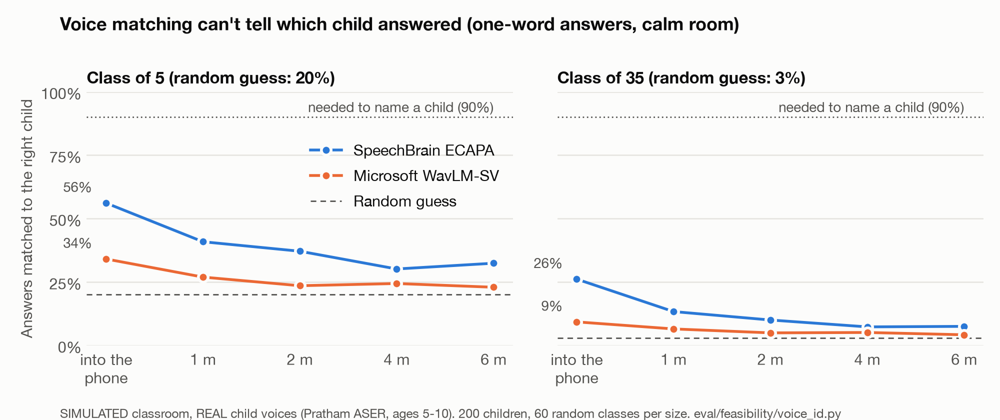

# Does SUNO work? Feasibility tests after the 20 Oct mentor call

> **Historical record.** This test is why SUNO changed design. Voice matching could not name the child, so SUNO stopped recording the classroom and now listens to the teacher's own after-class note (decision 20 in [decisions.md](decisions.md)). The "what stays" section below describes the design as it was on 20 Oct.

The technical mentor's challenge was that SUNO rests on one untested belief: that a phone can tell **which child** answered. If that fails, nothing else matters. So we split SUNO into the questions it must answer and test each on its own, before building any app.

| # | Question | Test | Data | Status |
|---|---|---|---|---|
| F1 | Can a voice sample tell us which child answered? | Voice matching against a one-time voice sample per child | Real child voices (Pratham ASER), simulated classroom | **Done: no** (below) |
| F1-real | Same, on a real recording | The mentor's home test | Our recordings | Superseded: no classroom recording (decision 20) |
| F2 | Can it tell a right reading from a wrong one? | Sarvam speech-to-text vs the expected word, against the ASER surveyor's label | Real child voices (ASER) | Superseded: no child speech is transcribed (decision 20) |
| F3 | Given a transcript, does Claude + code name a child only when it is certain? | Claude call 1 plus code checks on the mentor's hard cases | Synthetic transcripts | Became the pipeline simulation and the real-speech test (`eval/results/sim_pipeline.md`, `real_notes.md`) |

Every number here comes from a script in `eval/`. Results files are in `eval/results/`.

## F1 result: voice matching cannot tell us which child answered

**Verdict: no.** Off-the-shelf voice matching cannot name the child who answered. This holds even in the best case, with the child speaking straight into the phone, and in a classroom it is close to guessing. We drop voice as a way to attribute answers. The design change is in the next section.

**How we tested** (`eval/feasibility/voice_id.py`):
- **Voices:** 200 real children aged 5–10 from the Pratham ASER recordings (Hindi, Rajasthan and Uttar Pradesh). Classes were drawn from children recorded on the same device, as in a real classroom.
- **Voice sample:** each child "enrolled" with about 20 seconds of their own reading.
- **Answers tested:** their other, separate single-word readings, and three-word stretches.
- **Room:** a simulated 9 × 7 m classroom with a 0.8 s echo, ten murmuring children and a fan. The phone is worn by the teacher at the front.
- **Noise levels:** a "calm" room (the answer is 11 dB above the noise at 1 m) and a "noisy" one (2 dB).
- **Models:** two standard voice models, SpeechBrain ECAPA and Microsoft WavLM-SV.
- **Sampling:** 60 random classes per class size.

**Answers matched to the right child** (ECAPA, the better model; 95% intervals in `eval/results/f1_voice_id.md`):

| Where the child is | One word, class of 5 | One word, class of 35 | Three words, class of 35 |
|---|---|---|---|
| Speaking into the phone (best case) | 56% | 26% | 49% |
| 1 m from the teacher, calm room | 41% | 13% | 19% |
| 2 m, calm | 37% | 10% | 12% |
| 4–6 m, calm | 30–32% | 7–8% | 9–11% |
| 2 m, noisy | 28% | 5% | 6% |
| Random guess | 20% | 3% | 3% |

SUNO only names a child when it would be right at least 90% of the time. In the classroom, voice matching never reaches that, at any distance, class size or answer length. It got there only with the child speaking into the phone in a group of five, three-word answers, and even then only about half the answers.

**Why we believe it, and its limits:**
- **Checked first** (`eval/results/f1_sanity.md`):
  - the child's own voice dominates the clips (median pitch 258 Hz, a child's range);
  - recording on one device vs. 35 different devices barely changes the result (46% vs. 43% on a 10-second-vs-10-second check);
  - the audio keeps sound up to about 6 kHz, so it is not muffled.
- **Optimistic in places:** the answer is cleanly cut out (perfect speech detection) and never overlaps another voice.
- **Pessimistic in places:**
  - the ASER audio is low-bitrate MP3;
  - both models were trained on adult voices, and children's voices are known to be harder;
  - fine-tuning on child speech could help, but we have neither the data nor the time before 1 Nov.
- **Simulated room:** the home test (F1-real) checks this on a real one.

## What we change: SUNO knows who answered because the teacher tells it, not because it guesses

Voice can't carry attribution, so the design stops asking it to. Everything else in SUNO stays the same: Claude rebuilds moments and evidence, code checks and scores them, and the tracker, Silence Ledger and morning brief follow. The changes are about how a moment gets its child.

**1. One fixed reading slot (Decision 16).** The teacher starts SUNO for the 30–45 minute reading period and stops it after. It doesn't run all day, so battery and heat stay low and the phone stays free for calls.

**2. Today's call-on list, one tap each (Decision 3, now central).** Each morning the planner picks 4–6 children: those SUNO has heard least, plus those who need support. During the slot, their names sit as big buttons on the phone, with roll numbers so two Priyas stay distinct.
- When the teacher calls on one of them, by name or just by pointing, she taps that child's button. That's about 5 taps a day.
- She can tap "someone else" and pick any child from the roster.
- With a tap, SUNO is told who answered. It doesn't have to work it out.

**3. Call-ons come to the mic (Decision 2).** The planned call-ons happen near the teacher: the child reads one word at her desk, or she leans in at the bench. That puts the answer within about 1 m of the worn phone, where F1 and F2 show recognition is best.

**4. Name calls as a second, stricter signal (Decision 18).** With no tap, SUNO credits an answer only when the teacher's words name exactly one child on the roster and nothing contradicts it. Claude proposes the attribution; code checks that the name is really in the transcript and unique, and that no tap disagrees. Pointing, shared names without a roll number, a friend answering, and chorus answers all become "not known". F3 measures this on the mentor's cases.

**5. Voice matching is not used to name children.** At most it becomes a sanity check, for example flagging a tapped "answer" that is actually the teacher's own voice or many voices.

**What this costs and what it buys**

| | Before (Ideate deck) | Now |
|---|---|---|
| Who answered | Inferred from audio | The teacher's tap on a planned call-on, or a unique name she says; otherwise "not known" |
| Teacher effort | "No extra time" | About 5 taps a day, inside the normal reading period |
| Tests | None | Still none: these are ordinary call-ons |
| Recording | Whole lesson | One reading slot a day |
| Coverage | Everyone, in principle | 4–6 children a day, so every child is heard within about a week (Decision 8), and the Silence Ledger shows who hasn't been |
| Weak point | Attribution (F1 shows it fails) | Right vs wrong on child speech (F2), and whether teachers tap (teacher test, 24 Oct) |

**If teachers won't tap** (to be checked in teacher round 1 on 24 Oct), there are two fallbacks:
- **Names only.** SUNO keeps only unique-name calls and abstains on the rest. Fewer moments, same precision.
- **A 30-second voice note after the slot.** For example: "Priya — tree nahi aaya; Ravi — sab sahi". Claude structures it into evidence. This is the most robust option, but it relies on the teacher's memory.

**What stays innovative.** SUNO doesn't try to understand a whole noisy classroom. It turns the moments a teacher already creates into verified, per-child evidence:
- a planner decides whom to hear;
- a tap or a unique name anchors who spoke;
- the teacher's own reaction is the label;
- Claude rebuilds the evidence, and code refuses anything it can't verify;
- the Silence Ledger makes sure quiet children are not missed.

## What happened next
- **Decision 20 (27 Oct):** SUNO listens to the teacher, not the classroom. After the reading period she speaks a 60-second note; no child's voice is recorded.
- The questions F2 and F3 asked became the pipeline simulation (`eval/results/sim_pipeline.md`) and the real-speech test (`eval/results/real_notes.md`): does a claim land on the right child, in the right direction, and does an opinion ever become evidence?
